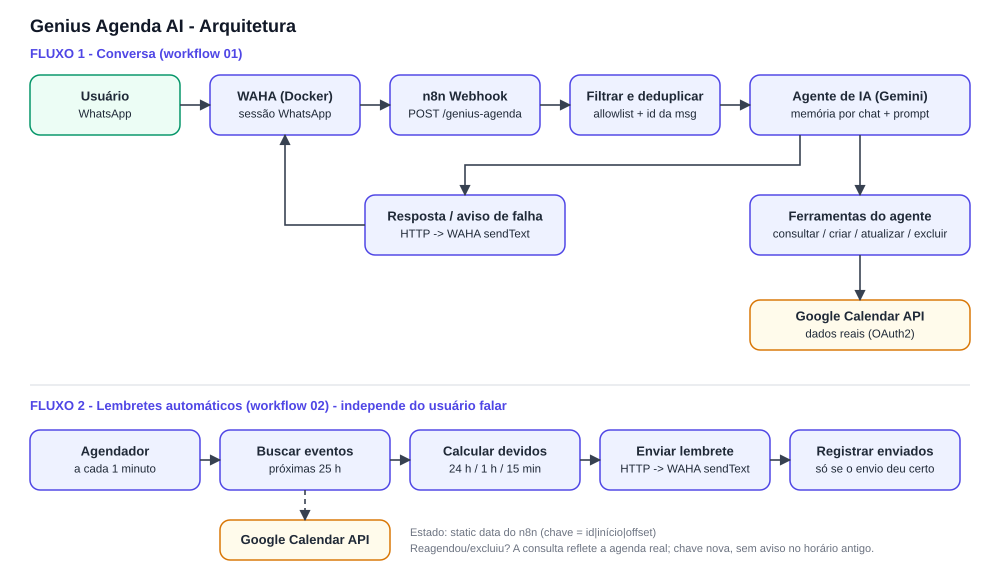
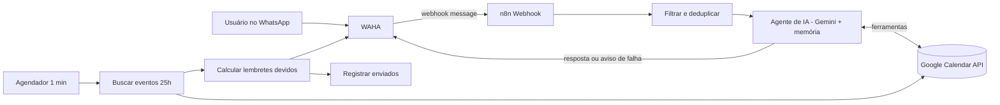

# Genius Agenda AI

Assistente pessoal de agenda no **WhatsApp**, integrado ao **Google Agenda**, que gerencia compromissos por linguagem natural, resume a agenda e envia **lembretes automáticos**. Construído com **n8n + WAHA + Gemini**, para o desafio *Auto Genius AI / Genius Agenda AI*.

> Exemplos: *"Marca uma reunião com o Yuri amanhã às 14h"*, *"Muda essa reunião para sexta às 10h"*, *"Cancela meu compromisso com o fornecedor"*, *"O que eu tenho de importante nesta semana?"*, *"Me prepara para a reunião que começa em 30 minutos"*.

## Sumário
1. [Arquitetura](#arquitetura)
2. [Cobertura do desafio](#cobertura-do-desafio)
3. [Pré-requisitos](#pré-requisitos)
4. [Instalação](#instalação)
5. [Configuração](#configuração)
6. [Uso](#uso)
7. [Lembretes](#lembretes)
8. [Testes](#testes)
9. [Segurança e privacidade](#segurança-e-privacidade)
10. [Estrutura do repositório](#estrutura-do-repositório)
11. [Limitações e melhorias futuras](#limitações-e-melhorias-futuras)

## Arquitetura





Dois workflows independentes:

| Workflow | Arquivo | Função |
|---|---|---|
| **01 - Agente WhatsApp** | `workflows/01_Genius_Agenda_Agente_WhatsApp.json` | Recebe a mensagem, filtra/deduplica, o agente consulta/cria/altera/exclui eventos e responde |
| **02 - Lembretes** | `workflows/02_Genius_Agenda_Lembretes.json` | A cada minuto lê a agenda real e envia os alertas, sem depender de o usuário falar |

A justificativa das escolhas (n8n, polling, estado, WAHA via HTTP etc.) está em [`docs/DECISOES_E_LIMITACOES.md`](docs/DECISOES_E_LIMITACOES.md).

## Cobertura do desafio

| Módulo | Status | Onde |
|---|---|---|
| 1 - Google Agenda (criar, consultar, alterar, excluir, conflitos, fuso) | ✅ (conflitos guiados por prompt) | Nós *Google Calendar Tool* + prompt do agente |
| 2 - Agente de IA (linguagem natural, datas relativas, ferramentas, perguntas) | ✅ | Nó *AI Agent* + prompt |
| 3 - WhatsApp (receber, responder, confirmar, tratar falhas) | ✅ | Webhook + HTTP/WAHA + saída de erro |
| 4 - Lembretes (24 h/1 h/15 min, configurável, reconciliação, sem duplicar, fuso) | ✅ | Workflow 02 |
| 5 - Inteligência visual | ⚠️ Parcial: classificação do tipo + briefing sob demanda; **sem imagem/card** | Workflow 02 e prompt |
| 6 - Arquitetura e confiabilidade (logs, retentativas, segredos, estado, docs) | ✅ | Este repositório |

Detalhes e lacunas honestas em [`docs/DECISOES_E_LIMITACOES.md`](docs/DECISOES_E_LIMITACOES.md).

## Pré-requisitos

- Docker e Docker Compose
- Uma conta Google (use um **calendário de teste com dados fictícios**)
- Um número de WhatsApp para parear com o WAHA (preferencialmente de teste)
- Chave gratuita do [Google AI Studio](https://aistudio.google.com/apikey) (Gemini)
- Node.js 20+ (apenas para rodar os testes)

## Instalação

```bash
git clone <URL_DO_SEU_REPOSITORIO> genius-agenda-ai
cd genius-agenda-ai

cp .env.example .env        # preencha os valores (chave do WAHA, senha, etc.)
docker compose --env-file .env -f docker-compose.example.yml up -d
```

- n8n: <http://localhost:5678>
- WAHA (dashboard e Swagger): <http://localhost:3000>

Se você já tem n8n e WAHA rodando, basta garantir que estejam **na mesma rede Docker** (o n8n alcança o WAHA em `http://waha:3000`).

## Configuração

### 1. Parear o WhatsApp no WAHA
No dashboard do WAHA, inicie a sessão (por padrão `default`) e leia o QR Code com o WhatsApp de teste. Anote o **nome da sessão**.

### 2. Importar os workflows
No n8n: **Workflows -> Add workflow -> ⋯ -> Import from file** e importe os dois arquivos de `workflows/`.

### 3. Criar as credenciais no n8n
| Credencial | Onde usar | Como obter |
|---|---|---|
| **Google Calendar OAuth2** | 4 nós de ferramenta (workflow 01) e nó *Buscar eventos* (workflow 02) | Ver abaixo |
| **Google Gemini (PaLM) API** | Nó *Gemini Chat Model* | Chave do Google AI Studio |
| **Header Auth** (`X-Api-Key` = `WAHA_API_KEY`) | Nós HTTP que enviam para o WAHA | Mesmo valor definido no `.env`. Se o WAHA não usa chave, mude *Authentication* para **None** |

**Google OAuth (passo a passo):**
1. No [Google Cloud Console](https://console.cloud.google.com/), crie um projeto e ative a **Google Calendar API**.
2. Configure a tela de consentimento como **Externo**, em modo **Teste**, e adicione **seu e-mail como usuário de teste**. (Tipo *Interno* causa o erro `403 org_internal` em contas `@gmail.com`.)
3. Crie um **ID do cliente OAuth** do tipo *Aplicativo da Web*.
4. Na credencial do n8n, copie a **OAuth Redirect URL** (ex.: `http://localhost:5678/rest/oauth2-credential/callback`) e cadastre em *URIs de redirecionamento autorizados*.
5. Cole o Client ID e o Client Secret no n8n e clique em **Sign in with Google**.

> Em modo de teste o token expira em 7 dias; refaça o *Sign in with Google* se o agente parar de ler a agenda.

### 4. Ajustar os valores dos nós
| Onde | O quê |
|---|---|
| Workflow 01 -> nó **Filtrar e deduplicar** | `ALLOWED`: seu ID de remetente (copie `payload.from` de uma execução; pode ser `...@c.us` ou `...@lid`) |
| Workflow 02 -> nó **Calcular lembretes devidos** | `OWNER` (destino dos lembretes) e `OFFSETS` (minutos antes: `[1440, 60, 15]`) |
| Nós HTTP (3) | `session`: nome da sessão do WAHA, se diferente de `default` |
| Nós Google Calendar | *Calendar*: `primary` ou o e-mail do calendário |
| Nó Gemini | Modelo: escolha um modelo Flash disponível na lista (o padrão do repositório é `gemini-3.8-flash`) |

### 5. Apontar o WAHA para o n8n
Se não usou o compose de exemplo, defina no WAHA:

```
WHATSAPP_HOOK_URL=http://n8n:5678/webhook/genius-agenda
WHATSAPP_HOOK_EVENTS=message
```

### 6. Publicar
**Publique (ative) os dois workflows.** A URL `/webhook/...` e o estado de deduplicação só funcionam com o workflow ativo (não em teste manual).

## Uso

Envie mensagens, do número autorizado, para o número conectado ao WAHA.

| Você diz | O agente faz |
|---|---|
| "Marca uma reunião com o Yuri amanhã às 14h" | Consulta conflitos, cria o evento e confirma com os dados retornados pela API |
| "Marca uma reunião amanhã à tarde" | Pergunta o horário exato |
| "Muda essa reunião para sexta às 10h" | Localiza o evento (pergunta qual, se houver mais de um) e atualiza |
| "Cancela meu compromisso com o fornecedor" | Identifica o evento, pede confirmação e só então exclui |
| "O que eu tenho de importante nesta semana?" | Consulta o intervalo real e resume |
| "Me prepara para a reunião que começa em 30 minutos" | Busca o evento e entrega um briefing curto |

Se a API falhar, o agente informa que **nada foi alterado**.

## Lembretes

- O workflow 02 roda **a cada 1 minuto**, independente de conversa, e lê os eventos das próximas 25 h.
- Envia alertas nos offsets configurados (padrão **24 h, 1 h e 15 min**), com tolerância de 5 min.
- **Sem duplicidade:** cada alerta tem a chave `id do evento | início | offset`, registrada **só depois** do envio bem-sucedido.
- **Alteração/exclusão:** como a agenda real é consultada a cada ciclo, um evento reagendado gera chave nova (sem aviso no horário antigo) e um evento excluído simplesmente desaparece.
- Horários exibidos em `America/Recife`.

## Testes

```bash
npm test      # Node.js 20+, sem dependências externas
```

Os testes executam o **código real dos nós** extraído dos JSON e validam: filtro e idempotência do webhook, cálculo e deduplicação dos lembretes, reagendamento, falha no envio, estrutura dos workflows e ausência de segredos. A validação do agente de IA e das integrações reais é feita pelos cenários de [`docs/CENARIOS_DE_TESTE.md`](docs/CENARIOS_DE_TESTE.md).

## Segurança e privacidade

- **Nenhum segredo no repositório.** Chaves e tokens ficam nas *Credenciais* do n8n (criptografadas com `N8N_ENCRYPTION_KEY`); o `.env` real está no `.gitignore` e um teste automatizado procura chaves nos arquivos.
- **Allowlist** de remetentes: só números autorizados acionam o agente; grupos e mensagens do próprio número são ignorados.
- **Permissão do Google:** a credencial do n8n concede acesso à agenda da conta que fez login. Use um calendário de teste com dados fictícios.
- **Privacidade:** o conteúdo dos eventos é enviado ao provedor do modelo (Gemini) para responder; evite dados sensíveis reais em testes.
- Antes de versionar um workflow exportado do n8n, **troque seus números reais pelos placeholders**.

## Estrutura do repositório

```
.
├── README.md
├── .env.example                  # variáveis de exemplo (sem segredos)
├── docker-compose.example.yml    # n8n + WAHA
├── package.json                  # npm test
├── workflows/
│   ├── 01_Genius_Agenda_Agente_WhatsApp.json
│   └── 02_Genius_Agenda_Lembretes.json
├── docs/
│   ├── arquitetura.svg
│   ├── DECISOES_E_LIMITACOES.md
│   ├── CENARIOS_DE_TESTE.md
│   └── ROTEIRO_VIDEO.md
└── tests/
    └── workflows.test.mjs
```

## Limitações e melhorias futuras

Principais limitações: sem geração de imagem/card visual; participantes registrados na descrição; conflitos e ambiguidade dependem do prompt; estado em *static data*; um usuário por instalação. Lista completa e plano de melhorias em [`docs/DECISOES_E_LIMITACOES.md`](docs/DECISOES_E_LIMITACOES.md).

## Entregáveis do desafio

| Entregável | Local |
|---|---|
| Repositório Git organizado | este repositório |
| README com instalação e configuração | `README.md` |
| Diagrama da arquitetura | `docs/arquitetura.svg` (e Mermaid acima) |
| Testes automatizados | `tests/` (`npm test`) |
| Vídeo de demonstração | *adicione o link aqui* (roteiro em `docs/ROTEIRO_VIDEO.md`) |
| Exemplo de variáveis de ambiente | `.env.example` |
| Limitações e melhorias futuras | `docs/DECISOES_E_LIMITACOES.md` |
